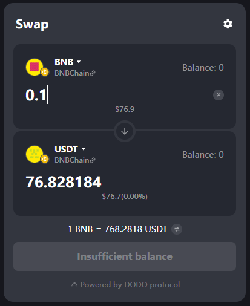

# DODO Swap Widget Quickstart (React and Vite)

A small, working example of the [DODO Swap Widget](https://www.npmjs.com/package/@dodoex/widgets) inside a React app, written for a developer who has never used DODO before. It goes from an empty folder to a live same chain quote (BNB to USDT on BNB Chain) and a wallet connection in about 20 minutes.

I built it because the Examples section of the [DODOEX/widgets](https://github.com/DODOEX/widgets) README points to `example/react-app` and `example/js-app`, which are no longer in the repo. Everything below was run and checked by hand, and every problem listed in "Things that tripped me up" really happened.



## Tested with

| Package | Version |
| --- | --- |
| @dodoex/widgets | 3.19.0 |
| React | 19.2 |
| Vite | 8.3 |
| vite-plugin-node-polyfills | 0.28 |
| Node.js | 24 |

## What you need

1. Node.js 18 or newer and npm.
2. A browser wallet such as MetaMask, only to test the wallet connection. Use a **new, empty account**. You only sign a login message and approve a connection. Never approve a transaction or a token approval while testing.

## Step 1. Create a React app

```bash
npm create vite@latest dodo-widget-quickstart -- --template react
cd dodo-widget-quickstart
npm install
```

The latest create-vite asks which linter to use. Either works, I picked ESLint.

## Step 2. Install the widget

```bash
npm install @dodoex/widgets
npm install -D vite-plugin-node-polyfills
```

The widget brings about 900 packages, so the first install takes a few minutes. You will see `npm warn ERESOLVE` lines about React versions and several `deprecated` lines. They come from the widget's own dependencies and the widget still works on React 19. Do not run `npm audit fix --force`, it can upgrade packages to versions the widget does not expect.

## Step 3. Get your own API key

1. Open the [DODO Developer Portal](https://developer.dodoex.io) and connect your empty wallet.
2. Create a project with the integration type **Web App / Mobile App**.
3. Copy the **Secret Key** with the copy icon.

Put it in a file called `.env.local` in the project folder.

```bash
VITE_DODO_API_KEY=paste_your_key_here
```

Vite only exposes variables that start with `VITE_`, and the default `.gitignore` already ignores `*.local`, so the key never reaches GitHub. Copy `.env.example` if you prefer.

Keep in mind that a Web App key is sent from the browser, so anyone using your page can see it in their network tab. That is normal for this key type. The portal showed a limit of 20 requests per IP per minute when I created the project, and the Starter plan page showed 60 per minute and 1,000,000 a month.

## Step 4. Add the polyfills to Vite

Replace `vite.config.js` with this.

```js
import react from '@vitejs/plugin-react'
import { defineConfig } from 'vite'
import { nodePolyfills } from 'vite-plugin-node-polyfills'

export default defineConfig({
  plugins: [react(), nodePolyfills({ include: ['buffer', 'util', 'process'] })],
})
```

Without it the console warns that the modules `buffer` and `util` were externalized, because some web3 libraries inside the widget expect Node.js built ins that Vite does not ship to the browser.

## Step 5. Show the widget

Replace `src/App.jsx` with this.

```jsx
import { SwapWidget } from "@dodoex/widgets";

const apiKey = import.meta.env.VITE_DODO_API_KEY;

// Starting tokens on BNB Chain (chain ID 56).
// "0xEeee...EEeE" is the standard placeholder address for a chain's own coin (here BNB).
const BNB = {
  chainId: 56,
  address: "0xEeeeeEeeeEeEeeEeEeEeeEEEeeeeEeeeeeeeEEeE",
  name: "BNB",
  symbol: "BNB",
  decimals: 18,
};
const USDT = {
  chainId: 56,
  address: "0x55d398326f99059ff775485246999027b3197955",
  name: "Tether USD",
  symbol: "USDT",
  decimals: 18,
};

export default function App() {
  return (
    <div style={{ display: "flex", justifyContent: "center", padding: 40 }}>
      <SwapWidget
        apikey={apiKey}
        colorMode="dark"
        defaultChainId={56}
        defaultFromToken={BNB}
        defaultToToken={USDT}
        crossChain={false}
        width={400}
        dappMetadata={{ name: "DODO Widget Quickstart" }}
      />
    </div>
  );
}
```

| Prop | What it does |
| --- | --- |
| `apikey` | Your key from the portal. Note the lowercase spelling. |
| `colorMode` | `"dark"` or `"light"`. |
| `defaultChainId` | The network the widget asks the wallet to use. 1 is Ethereum, 56 is BNB Chain, 8453 is Base, 42161 is Arbitrum, 137 is Polygon. |
| `defaultFromToken` and `defaultToToken` | The starting pair. See the notes below, they have two catches. |
| `crossChain` | `false` keeps quotes on one chain. With `true` the widget can quote bridge routes between chains. |
| `width` | Width in pixels, the minimum is 292. |
| `dappMetadata` | The app name a wallet shows when you connect. |

## Step 6. Run it

```bash
npm run dev
```

Open http://localhost:5173 and type an amount of BNB. You should see a USDT quote and a rate such as `1 BNB = 769.2262 USDT`. Connect your empty wallet and the button changes to "Insufficient balance", which is the right answer for an empty account.

## Things that tripped me up

1. **The test key in the docs is rejected.** The key shown in the Getting Started page returns `401 Invalid API key in request`. Because that error reply carries no CORS header, the browser console shows a CORS error instead, which sends you looking in the wrong place. The widget just says "Quote not available". Use your own key from the portal.
2. **The prop is `apikey`, all lowercase.** That is how the widget's own type definitions spell it, while one docs page writes `apiKey`. Copy the lowercase form.
3. **`defaultChainId` does not change the starting tokens.** It only sets the network the widget asks the wallet for. The starting pair is ETH and USDC on Ethereum unless you set `defaultFromToken` and `defaultToToken`. Once a wallet is connected, the wallet's current network takes over.
4. **The widget remembers the last tokens you picked, and they win over your defaults.** It stores them in `localStorage` under `DODO_WIDGET_LAST_FROM_TOKEN` and `DODO_WIDGET_LAST_TO_TOKEN`. When you change your defaults and nothing happens, clear them in the browser console.

   ```js
   localStorage.removeItem("DODO_WIDGET_LAST_FROM_TOKEN");
   localStorage.removeItem("DODO_WIDGET_LAST_TO_TOKEN");
   ```

5. **Write token addresses in lowercase.** The widget looks up your default token in its token list by exact address text, so the check is case sensitive. The mixed case (checksummed) address that BscScan shows, `0x55d398326f99059fF775485246999027B3197955`, did not work even after clearing the saved tokens, and the widget fell back to USDC on Ethereum. The lowercase address worked at once. EVM addresses are not case sensitive anywhere else, so this is easy to miss.
6. **A fallback pair can turn into a bridge quote.** When the default "to" token was not found, the widget paired BNB on BNB Chain with USDC on Ethereum and quoted a route through the Swft bridge (about 10 minutes and a fee), even with `crossChain={false}` set. Bridging is a real feature, but not what you want in a same chain demo, so check that both default tokens actually loaded.
7. **The Vite polyfills are needed**, see Step 4.
8. **The README's example folders are gone.** `example/react-app` and `example/js-app` are no longer in DODOEX/widgets, which is why this repo exists.

## Known issue

The console shows `GET .../locales/en-US.js 404`. The widget has English built in, then tries to load its language file with a dynamic import that neither Vite's dev optimizer nor the production build resolves. The error is caught inside the widget and English keeps working, so it is harmless unless you set `locale` to Chinese. It happens in `vite build` output too.

## Other ways to use the widget

The Developer Portal also offers a hosted page (`swap.dodoex.io/your-project`) and an iframe, both configured with a form instead of code. This repo covers the SDK route, where everything is set in your own code.

## Useful links

1. [Widget Getting Started](https://docs.dodoex.io/en/developer/developers-portal/widget/getting-started)
2. [Widget Config](https://docs.dodoex.io/en/developer/developers-portal/widget/widget-config)
3. [DODO Developer Portal](https://developer.dodoex.io)
4. [DODOEX/widgets on GitHub](https://github.com/DODOEX/widgets)

## About

Made by Sri Madhav ([github.com/srimadhavsats](https://github.com/srimadhavsats)), in crypto since 2012. Issues and suggestions are welcome.
